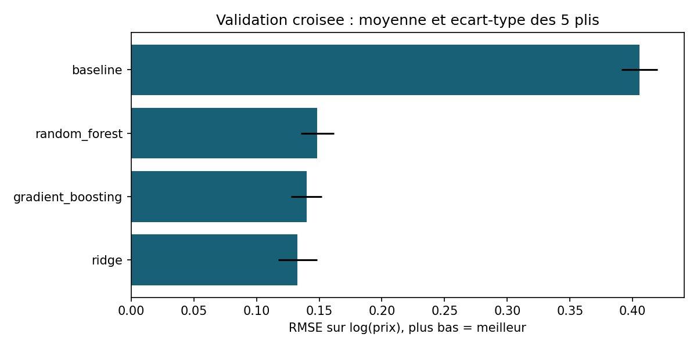

# Apprentissage supervise : experiences et analyses

Ce depot rassemble mes travaux sur des jeux de donnees Kaggle. Les notebooks
originaux sont conserves ; House Prices dispose maintenant d'une etude
reproductible avec selection des modeles, test interne et analyse des erreurs.

## House Prices : une regression doit-elle etre complexe ?

**Comparer Ridge, foret aleatoire et gradient boosting avec un meme protocole,
puis verifier ce que les scores ne racontent pas.**

Sur 1 168 logements de developpement, la regression Ridge obtient la meilleure
RMSE moyenne sur log(prix) parmi les configurations essayees. Les pretraitements
sont appris dans chacun des cinq plis ; les 292 logements du test interne
ne participent pas a cette selection.

| Modele | RMSE(log), moyenne CV | Ecart-type entre plis |
| --- | ---: | ---: |
| Reference constante | 0,4054 | 0,0144 |
| Ridge | **0,1328** | 0,0157 |
| Foret aleatoire | 0,1485 | 0,0132 |
| Gradient boosting | 0,1399 | 0,0123 |

Ces ecarts-types ne sont pas des intervalles de confiance. La comparaison
porte sur une grille limitee, pas sur toutes les configurations possibles.

### Le test final revele une limite importante

| Modele | RMSE(log) | MAE en dollars | RMSE en dollars | R2 |
| --- | ---: | ---: | ---: | ---: |
| Reference constante | 0,3740 | 51 929 $ | 80 557 $ | -0,048 |
| Ridge retenu | 0,1798 | 20 645 $ | 110 805 $ | -0,982 |

Ridge ameliore la MAE et la RMSE logarithmique, mais **pas la RMSE en dollars**.
Une prediction extreme explique environ 96 % de la somme des erreurs au carre.
Elle est conservee dans les scores et discutee dans l'[analyse des resultats](house_prices/RESULTS.md).
Le modele n'est donc pas presente comme un estimateur immobilier pret a l'emploi.

### Explorer ou reproduire

- [Protocole, donnees et commandes](house_prices/README.md).
- [Script commente](house_prices/experiment.py).
- [Resultats et limites](house_prices/RESULTS.md).
- [Notebook original House Prices](regression.ipynb), inchange.
- [Notebook original Titanic](titanic.ipynb), exploration distincte, inchangee.

Python 3.11+ ; versions principales testees dans `requirements-study.txt`.
Les donnees Kaggle et les modeles ajustes restent locaux et ne sont pas publies.
