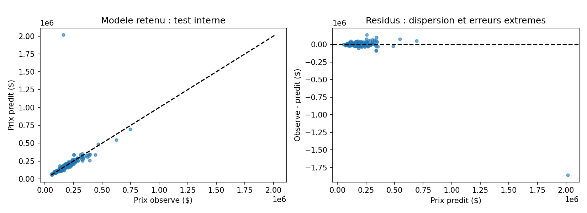

# Resultats et discussion

Les chiffres sont issus de l'execution locale,
pas du leaderboard Kaggle. Le [protocole](README.md) et les
[parametres enregistres](results/protocol.json) permettent de la reproduire.

## 1. La complexite ne garantit pas le meilleur ajustement hors entrainement

Ridge avec alpha = 100 obtient une RMSE logarithmique moyenne de 0,1328 sur
les cinq plis, contre 0,1399 pour le gradient boosting et 0,1485 pour la foret.
La reference constante obtient 0,4054.

La foret a pourtant une erreur d'entrainement bien plus basse : 0,0545,
contre 0,1178 pour Ridge. Cet ecart entrainement-validation est compatible
avec davantage de surapprentissage, sans demontrer une inferiorite generale
des forets. Les budgets et grilles explores sont limites et differents.

Les moyennes utilisees pour selectionner les parametres ne sont pas des
estimations non biaisees de la performance du modele selectionne.

## 2. Une bonne MAE peut coexister avec une mauvaise RMSE

Sur les 292 logements du test interne, Ridge obtient :

- RMSE sur log(prix) : **0,1798**, contre 0,3740 pour la reference.
- MAE : **20 645 $**, contre 51 929 $ pour la reference.
- RMSE en dollars : **110 805 $**, contre 80 557 $ pour la reference.
- R2 : **-0,982**, contre -0,048 pour la reference.

Le R2 negatif ne doit pas etre masque : les erreurs au carre depassent
celles d'une prediction constante a la moyenne du test. La reference du
projet est differente : elle utilise la moyenne des log-prix du developpement.

## 3. Un cas d'extrapolation a examiner

Le logement Id 1299 a un prix observe de 160 000 $ et un prix predit de
2 015 662 $. Cette erreur represente **96,05 %** de la somme des residus au
carre du test. Sa surface GrLivArea vaut 5 642, au-dela du maximum de 4 676
observe dans le developpement. La combinaison d'une extrapolation lineaire
sur log(prix) et du retour exponentiel est une explication plausible de
l'amplitude de la prediction, pas une preuve causale isolee.

L'erreur absolue mediane du test vaut 8 883 $, et son 95e percentile 48 848 $.
Ces statistiques de distribution completent la RMSE ; elles ne la remplacent
pas et aucun logement n'a ete retire du calcul final.

Il serait incorrect de supprimer cette maison apres consultation du test
puis de presenter le nouveau score comme une evaluation intacte.

## 4. Ce que l'on peut conclure

Dans cette grille et sur ce decoupage, Ridge est selectionne par la validation
et reduit l'erreur absolue moyenne, mais reste vulnerable a une erreur extreme.
Le critere logarithmique optimise et le risque d'erreur en dollars ne sont pas
interchangeables. Le modele n'est pas suffisamment robuste pour un usage reel.

Une experience suivante pourrait etudier les transformations des surfaces,
des modeles robustes et un choix multicritere. Elle devrait definir ses choix
sur le developpement, utiliser par exemple une validation imbriquee, et annoncer
que le test actuel a deja ete consulte. Elle n'est pas incluse dans ces resultats.

## Fichiers de preuve

- [Comparaison de validation](results/validation.csv).
- [Metriques de test](results/test-metrics.csv).
- [Protocole, versions et empreinte des donnees](results/protocol.json).
- Grilles completes, indices et predictions individuelles generes localement dans `artifacts/`.

Les donnees brutes et les predictions individuelles ne sont pas ajoutees au
depot. Les figures et tableaux agreges documentent l'experience sans republier
le jeu de donnees.
